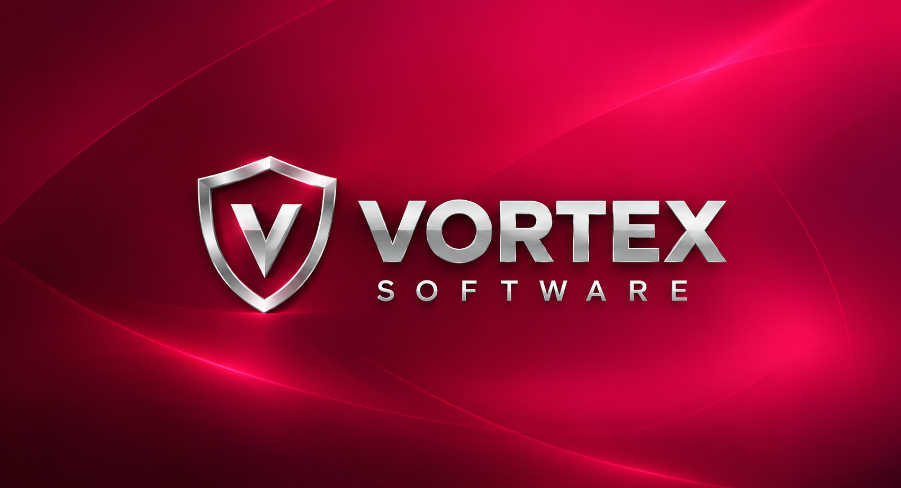

# Vortex Trading Terminal

> An educational and portfolio-oriented financial trading platform developed by Vortex Software.

Projeto de terminal financeiro web original para estudar engenharia de software, dados de mercado e simulação de estratégias. O desenvolvimento segue etapas revisáveis, com responsabilidade clara sobre cálculos e execução.



## Estágio atual

<!-- ESTAGIO-ATUAL: TASK 1.0 -->
**TASK 1.0** — primeiro modelo de persistência real: o agregado `Order` e seus fills em PostgreSQL, com a primeira migration (ADR-035). Anteriormente, a TASK 0.42 entregou o workflow de execução de ordem única (ADR-032, ADR-033 e ADR-034, todos aceitos).

A visão de produto é um **app web** de operação em ambiente **simulado**: Paper Trading de ponta a ponta, hospedado futuramente na VPS da Vortex Software. O frontend hoje apresenta o histórico de demonstração; a operação chega nas etapas seguintes do roadmap.

## O que já existe

| Área | Estado |
| --- | --- |
| Domínio financeiro | `Money`, `Price`, `Quantity`, `Currency` com precisão decimal exata; `Instrument`, `Symbol`, `Venue`, `AssetClass`, `Candle`, `Quote`, `Trade`; `UtcInstant` para tempo UTC |
| Ordens | `Order` e `OrderFill` com ciclo de vida, identidade de execução e conservação de quantidade provada em unidades inteiras de 10⁻²⁸ |
| Execução | `IExecutionProvider`, fatos normalizados (`Accepted`/`Rejected`/`Fill`/`Cancelled`), falhas operacionais e `OrderExecutionWorkflow` |
| Market Data | Porta de provider, orquestrador, provider de simulação determinístico e provider histórico de replay |
| Replay | `ReplaySession`, `ReplayTimeline`, `CausalReplaySession` com semântica de disponibilidade temporal, sem uso de dados futuros |
| Indicadores | SMA, EMA, MACD, RSI, ATR, Stochastic, Bollinger Bands, VWAP, ADX e OBV com consumo em lote e runtime causal em replay |
| Charts | Endpoint `POST /api/chart-snapshots` (somente Development) e página inicial com candles de um minuto |
| Persistência | `Order` e `OrderFill` em PostgreSQL, schema `trading`, valores exatos como `numeric` sem precisão declarada, enums por nome e primeira migration aplicada |
| Infraestrutura | Health checks `live` e `ready`; PostgreSQL e Redis no Compose local |

Ainda **não** implementados: Paper Exchange, Portfolio/posições, Risk, Backtesting, Strategy Lab, Algo Trading, autenticação, APIs de ordem e deploy.

## Arquitetura e stack

- Modular Monolith com limites internos explícitos e dependências orientadas ao domínio (**ADR-001**).
- Backend: C# e ASP.NET Core sobre **.NET 10 LTS**.
- Frontend: **Next.js**, React e TypeScript.
- Persistência: **PostgreSQL**, EF Core e Npgsql (**ADR-003**).
- Valores financeiros exatos usam `decimal` com regras explícitas de arredondamento (**ADR-002**).
- Real-time e cache futuros: SignalR e Redis conforme necessidade.
- Infraestrutura: containers Linux, Docker Compose e VPS com Nginx.

Referências de compilação aprovadas:

```text
Domain         → nenhuma referência de projeto
Application    → Domain
Infrastructure → Application + Domain
Api            → Application + Infrastructure
```

Consulte a [visão arquitetural](docs/architecture/overview.md) e os [ADRs](docs/adr/), atualmente 35 decisões aceitas.

## Validação

Pré-requisito de backend: SDK .NET `10.0.401` ou patch estável posterior da mesma faixa `10.0.4xx`, conforme `global.json`.

```sh
dotnet tool restore
dotnet restore VortexTrading.slnx
dotnet build VortexTrading.slnx --no-restore
dotnet test VortexTrading.slnx --no-build
```

`rollForward: latestPatch` permite correções de patch na mesma feature band sem avançar para outra faixa, versão minor ou major. Previews estão desabilitados. Desenvolvimento e CI usam essa política; para reprodução estrita, ambos devem selecionar o mesmo patch instalado.

Pré-requisito de frontend: Node 24.x e npm 11.x, em `apps/web`:

```sh
npm ci
npm run lint
node --experimental-strip-types --test tests/charts-adapter.test.mjs
npm run build
npm run dev
```

A API não possui launch profile. Da raiz:

```sh
dotnet run --project src/VortexTrading.Api --no-launch-profile -- --environment Development --urls http://127.0.0.1:5187
```

A connection string local fica em User Secrets (`ConnectionStrings:PostgreSQL`); não há valor funcional versionado. A infraestrutura local de PostgreSQL e Redis está descrita em [development-infrastructure.md](docs/architecture/development-infrastructure.md).

## Princípios

- Valores financeiros exatos usam precisão decimal e regras explícitas de arredondamento.
- Dados e execução são desacoplados dos providers externos.
- Indicadores têm uma implementação central reutilizável.
- Estratégias de usuários não executarão código arbitrário ou comandos do sistema.
- Secrets ficam fora do Git; `.env.example` é permitido somente com placeholders.
- Dependências e versões são revisadas por etapa.

## Roadmap macro

1. Baseline de engenharia e arquitetura. **Concluído.**
2. Bootstrap revisado do frontend, testes e infraestrutura de desenvolvimento. **Concluído.**
3. Dados simulados/autorizados, visualização e Paper Trading. **Em andamento:** dados e visualização prontos; persistência de ordens pronta; Paper Trading em desenvolvimento.
4. Portfolio, Risk e indicadores centrais. Indicadores concluídos; Portfolio e Risk pendentes.
5. Replay, backtesting, Strategy Lab e runtime de estratégias. Replay concluído; backtesting, Strategy Lab e runtime pendentes.
6. Observabilidade, automação de validação e deploy. CI implementado; observabilidade e deploy pendentes.

## Escopo e referências

O projeto não é um produto de corretagem e não oferece recomendação de investimento. A execução é exclusivamente Paper Trading, em ambiente simulado. Os dados são simulados ou devidamente autorizados; dados reais dependerão de permissões e condições do fornecedor.

Não há afiliação com Nelogica, Profit ou outras plataformas usadas como referências conceituais. Código, marca, textos, identidade visual, layouts proprietários e ativos de terceiros não são copiados.

O gráfico usa `lightweight-charts@5.2.1` (Apache-2.0) com a logo de atribuição da TradingView habilitada. Detalhes em [apps/web/README.md](apps/web/README.md) e na [vertical slice do gráfico](docs/architecture/historical-chart-vertical-slice.md).
