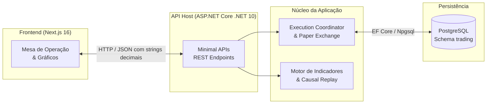
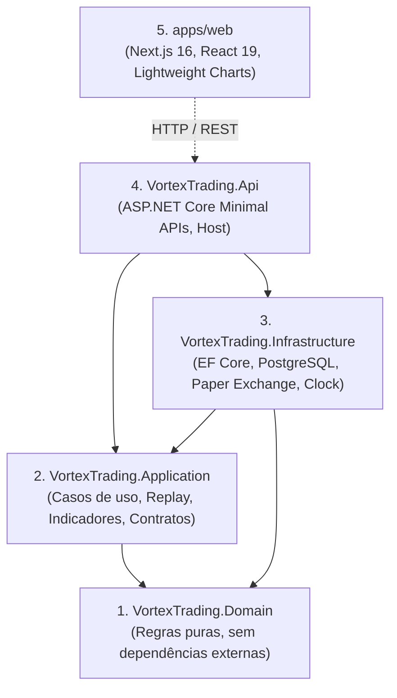
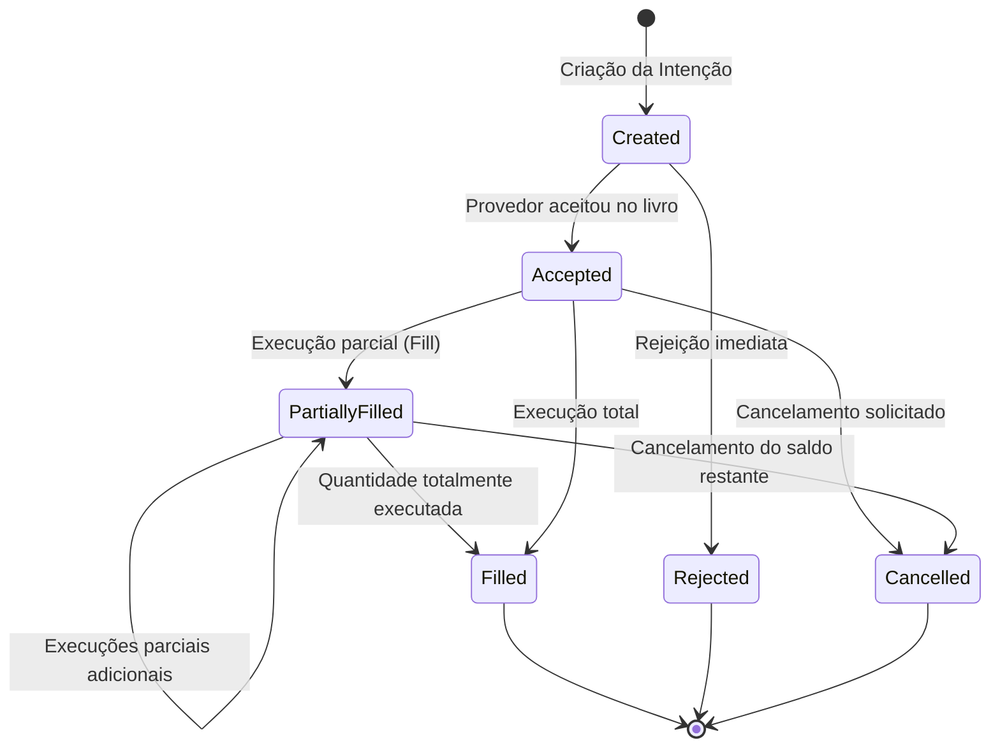

# Vortex Trading Terminal — Documento de Apresentação e Guia de Estudo

> **Objetivo**: Este documento serve como material de referência, apresentação técnica e guia didático para estudo e evolução do projeto **Vortex Trading Terminal**, desenvolvido pela Vortex Software.

---

## 1. Visão Geral e Propósito

O **Vortex Trading Terminal** é uma plataforma educacional e de portfólio de engenharia de software voltada ao mercado financeiro. Seu propósito central é simular de ponta a ponta a operação de um terminal de negociação (*Paper Trading*), aplicando os mais altos padrões de design de software, modelagem de domínio rica, determinismo temporal e precisão aritmética exata.



### Pilares Fundamentais do Projeto:
1. **Precisão Financeira Estrita**: Nenhuma utilização de tipos de ponto flutuante binário (`float` ou `double`) para grandezas monetárias. Conservação matemática com resolução de até \(10^{-28}\).
2. **Sem Viés Temporal (*No Look-Ahead Bias*)**: Tanto o mecanismo de simulação quanto o motor de replay histórico e indicadores respeitam rigorosamente a causalidade temporal. O sistema não tem acesso a dados futuros.
3. **Arquitetura Limpa e Desacoplada**: Separação inflexível de responsabilidades entre regras matemáticas puras, orquestração de casos de uso, infraestrutura de I/O e camada de apresentação.
4. **Determinismo**: Dado o mesmo conjunto de eventos e preços observados, o resultado contábil e as execuções de ordens são 100% reproduzíveis.

---

## 2. Arquitetura de Software: Monólito Modular

O sistema foi concebido como um **Modular Monolith** ([ADR-001](adr/ADR-001-modular-monolith.md)), evitando a complexidade operacional prematura de microsserviços enquanto preserva fronteiras conceituais rígidas.

### Grafo de Dependências de Compilação



> [!IMPORTANT]
> O projeto `VortexTrading.Domain` **não possui nenhuma referência de pacote NuGet, framework web ou biblioteca de banco de dados**. Ele contém apenas tipos C# puros, garantindo independência tecnológica e testabilidade máxima.

---

## 3. Modelagem Financeira e Domínio Rico

### 3.1. Primitivas e Prevenção de Erros de Ponto Flutuante
No padrão IEEE 754 (`float`/`double`), frações decimais simples como `0.1` ou `0.05` sofrem imprecisão binária cumulativa. No Vortex:
- `Money`: Associa uma quantia `decimal` a uma `Currency`. Operações de soma e subtração validam igualdade de moeda.
- `Price` e `Quantity`: Tipos imutáveis (`sealed record`) com validação de não-negatividade e preservação da escala original.
- `ExactDecimal`: Implementa rotinas de derivação matemática exata, divisões racionais e controle de arredondamento explícito.

### 3.2. Ciclo de Vida da Ordem e Invariantes
O agregado `Order` implementa uma máquina de estados finita explícita:



**Regra de Conservação de Quantidade**:
Para qualquer ordem em qualquer momento da simulação, a seguinte invariante é matematicamente verdadeira:
\[
\text{ExecutedQuantity} + \text{RemainingQuantity} = \text{InitialQuantity}
\]

### 3.3. Contabilidade de Portfólio (Custo Médio Ponderado)
O módulo de portfólio (`Portfolio` e `Position`) é derivado de forma pura a partir dos fills recebidos:
- **Custo Médio**: Atualizado a cada compra sucessiva.
- **P&L Realizado**: Apurado no momento da venda com base no custo médio acumulado.
- **P&L Não Realizado (Mark-to-Market)**: Calculado dinamicamente contra a última cotação observada da sessão:
\[
\text{UnrealizedPnL} = (\text{CurrentPrice} - \text{AveragePrice}) \times \text{PositionQuantity}
\]

---

## 4. Mecanismo de Execução e Paper Exchange

O motor de execução foi desenhado para eliminar aleatoriedades e comportamentos irreais:

1. **`PaperExecutionProvider`**:
   - **Preenchimento no Preço Limite**: Ordens de limite de compra só executam se o mercado negociar em preço menor ou igual ao limite (preenchendo no preço limite estipulado).
   - **Liquidez Finita e Fills Parciais**: Não assume liquidez infinita; ordens de volume expressivo podem ser preenchidas em múltiplas fatias.
   - **Ordem de Fila FIFO**: Ordens submetidas no mesmo nível de preço respeitam a ordem cronológica de chegada.
2. **`ExecutionCoordinator`**:
   - Único consumidor dos relatórios de execução (*Single-Consumer Pattern*).
   - Evita condições de corrida em concorrência multithread.
   - Garante que eventos sejam drenados e persistidos antes que novas operações alterem o livro.
3. **`SimulationClock`**:
   - O tempo da ordem não é o relógio da máquina. É o horário do último negócio publicado pelo feed. Esse feed lê o Yahoo Finance e só avança enquanto o pregão regular da B3 está aberto.

---

## 5. Market Data, Replay Histórico e Indicadores

### 5.1. Causalidade Temporal em Replay
O `CausalReplaySession` garante que simulações e cálculos de indicadores trabalhem sob o paradigma *as-of*:
- Dados de uma barra só ficam disponíveis no momento em que ela se encerra.
- Evita o erro comum em backtests onde uma estratégia "vê" o preço de fechamento antes de fechar a barra.

### 5.2. Catálogo Centralizado de Indicadores
Todos os 10 indicadores técnicos foram implementados de maneira unificada e testados contra benchmarks analíticos:

| Indicador | Sigla | Tipo | Propósito |
| :--- | :--- | :--- | :--- |
| **Simple Moving Average** | SMA | Tendência | Média aritmética simples de preços de fechamento |
| **Exponential Moving Average** | EMA | Tendência | Média com peso exponencial decrescente |
| **Moving Average Convergence Divergence** | MACD | Momento | Relação entre EMAs rápida e lenta, linha de sinal e histograma |
| **Relative Strength Index (Wilder)** | RSI | Oscilador | Mede velocidade e mudança dos movimentos de preço (0 a 100) |
| **Average True Range (Wilder)** | ATR | Volatilidade | Mede a amplitude real média de negociação |
| **Stochastic Oscillator** | Stoch | Oscilador | Posição do fechamento em relação ao range recente (%K e %D) |
| **Bollinger Bands** | BB | Volatilidade | Bandas de desvio padrão em torno de uma SMA |
| **Volume Weighted Average Price** | VWAP | Preço Ponderado | Relação acumulada entre volume financeiro e volume físico |
| **Average Directional Index (Wilder)** | ADX | Força de Tendência | Intensidade da tendência (+DI, -DI e ADX) |
| **On-Balance Volume** | OBV | Fluxo de Volume | Volume acumulado baseado no sentido do candle |

---

## 6. Persistência e Infraestrutura

### Banco de Dados (PostgreSQL)
- **Schema dedicado**: `trading`.
- **Mapeamento EF Core**:
  - `orders`: Cabeçalho das ordens (`Id`, `Side`, `Type`, `Quantity`, `LimitPrice`, `Status`, `CreatedAt`, etc.).
  - `order_fills`: Histórico imutável de preenchimentos vinculados à ordem.
- **Tipos no Banco**:
  - Enums persistidos como `text` para legibilidade e desacoplamento de índices ordinais.
  - Valores monetários persistidos como `numeric` sem precisão declarada no PostgreSQL, preservando a exatidão arbitrária definida no C#.

### Ambiente Docker e Produção
- **Desenvolvimento Local (`infra/`)**:
  - PostgreSQL 18.6 na porta `5432`.
  - Redis 8.10 na porta `6379`.
- **Produção (`deploy/`)**:
  - Containers Docker multi-stage baseados em Alpine/Linux com execução em usuários não-root.
  - Serviço separado para aplicação de migrations (`dotnet-ef database update`) desacoplado da inicialização da API.
  - Gateway de entrada com Nginx.

---

## 7. Frontend do Terminal

Construído em **Next.js 16 (App Router)** e **React 19**:

- **Interface da Mesa de Operação** (`apps/web/src/components/trading-panel.tsx`):
  - Formulário de envio de ordens (Mercado / Limite).
  - Listagem em tempo real de ordens com ações de cancelamento condicional.
  - Painel de Posição com cálculo de preço médio, quantidade e P&L.
- **Gráfico de Candles** (`apps/web/src/components/historical-chart.tsx`):
  - Utiliza `lightweight-charts` (versão 5.2.1).
  - Exibe candles de 1 minuto em conjunto com SMA(20) e painel inferior de MACD.
- **Regra de Apresentação Numérica**:
  - O código do cliente **não faz contas monetárias**.
  - As bibliotecas de formatação (`apps/web/src/lib/trading/format.ts`) tratam strings decimais para inserção de separadores de milhar e pontuação sem arredondar dígitos significativos.

---

## 8. Guia Prático para Execução e Estudo

### 8.1. Pré-requisitos
- **.NET SDK**: `10.0.401` ou patch compatível da faixa `10.0.4xx`.
- **Node.js**: `24.x` e **npm**: `11.x`.
- **Docker Engine**: Para execução dos serviços de banco de dados e cache.

### 8.2. Comandos de Inicialização

#### 1. Subir a Infraestrutura (Banco e Cache)
```bash
docker compose -f infra/compose.yaml up -d
```

#### 2. Restaurar, Compilar e Rodar os Testes
```bash
dotnet restore VortexTrading.slnx
dotnet build VortexTrading.slnx --no-restore
dotnet test VortexTrading.slnx --no-build
```

#### 3. Iniciar a API Backend
```bash
dotnet run --project src/VortexTrading.Api --no-launch-profile -- --environment Development --urls http://127.0.0.1:5187
```

#### 4. Iniciar o Frontend
```bash
cd apps/web
npm ci
npm run dev
```
Acesse a aplicação no navegador em: `http://localhost:3000`.

---

## 9. Roteiro Sugerido de Estudo do Código

Para quem for estudar este repositório, recomenda-se a seguinte sequência pedagógica:

1. **Fundamentos do Domínio**:
   - Leia `src/VortexTrading.Domain/Trading/Money.cs` e `Price.cs`. Observe como objetos de valor imutáveis protegem invariantes.
   - Analise `src/VortexTrading.Domain/Common/ExactDecimal.cs` para ver como operações financeiras contornam truncamentos.
2. **Máquina de Estados da Ordem**:
   - Abra `src/VortexTrading.Domain/Trading/Order.cs` e acompanhe os métodos `Accept`, `ApplyFill` e `Cancel`.
   - Veja como as transições de status geram novos estados válidos e disparam exceções diante de transições ilegais.
3. **Contabilidade de Carteira**:
   - Inspecione `src/VortexTrading.Domain/Portfolio/Position.cs` e a lógica de ponderação de preço médio.
4. **Mecanismo de Execução e Coordenação**:
   - Estude `src/VortexTrading.Infrastructure/Trading/Paper/PaperExecutionProvider.cs` para entender como uma corretora/bolsa simulada processa um livro de ofertas determinístico.
   - Veja `src/VortexTrading.Application/Trading/Execution/ExecutionCoordinator.cs` para ver o fluxo de aplicação e emissão de eventos de negócio estruturados.
5. **Decisões Arquiteturais (ADRs)**:
   - Leia os arquivos na pasta `docs/adr/`, especialmente:
     - `ADR-001` (Modular Monolith)
     - `ADR-002` (Tipos numéricos financeiros)
     - `ADR-017` (Execução de Replay Causal)
     - `ADR-036` (Paper Execution Provider determinístico)
     - `ADR-042` (Visibilidade Operacional)

---

## 10. Desafios e Extensões Sugeridas para Aprendizado

Caso deseje evoluir o projeto como exercício prático:
- **Desafio 1 (Pregão Yahoo)**: O módulo `Risk` já existe. Acompanhe uma leitura desde `YahooMarketFeed` e `ApplyMarketRound` até a cotação, o candle e o livro, e explique por que o tape congela quando o pregão encerra e por que o valor do ponto entra só na leitura da API, fora de `Position`.
- **Desafio 2 (Indicador Técnico)**: Adicionar um novo indicador à engine (ex: *Commodity Channel Index - CCI* ou *Keltner Channels*), criando a suite de testes unitários causal e batch correspondente.
- **Desafio 3 (Real-Time)**: Substituir o mecanismo de polling do frontend (`TradingPanel`) por um canal em tempo real baseado em **SignalR** ou **Server-Sent Events (SSE)**.
- **Desafio 4 (Strategy Engine)**: Implementar um avaliador simples de estratégias (*Moving Average Crossover*) que consuma os eventos de replay e gere ordens de compra e venda automaticamente.
