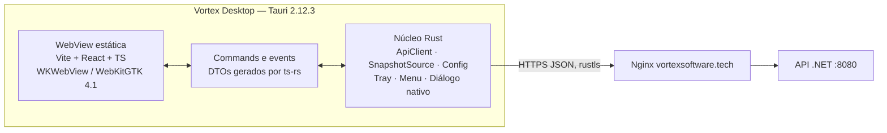
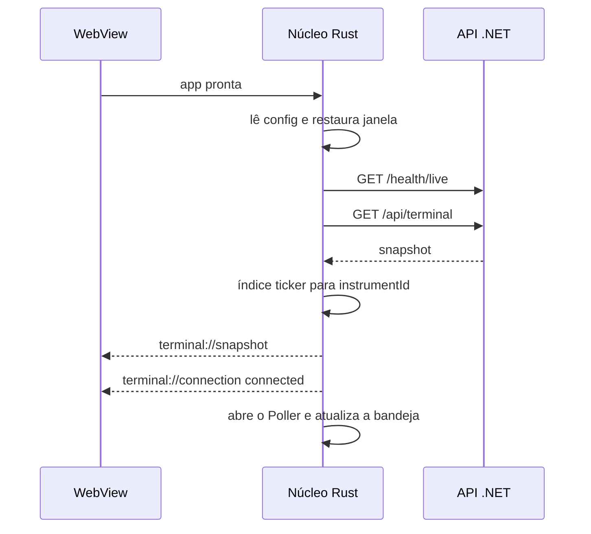
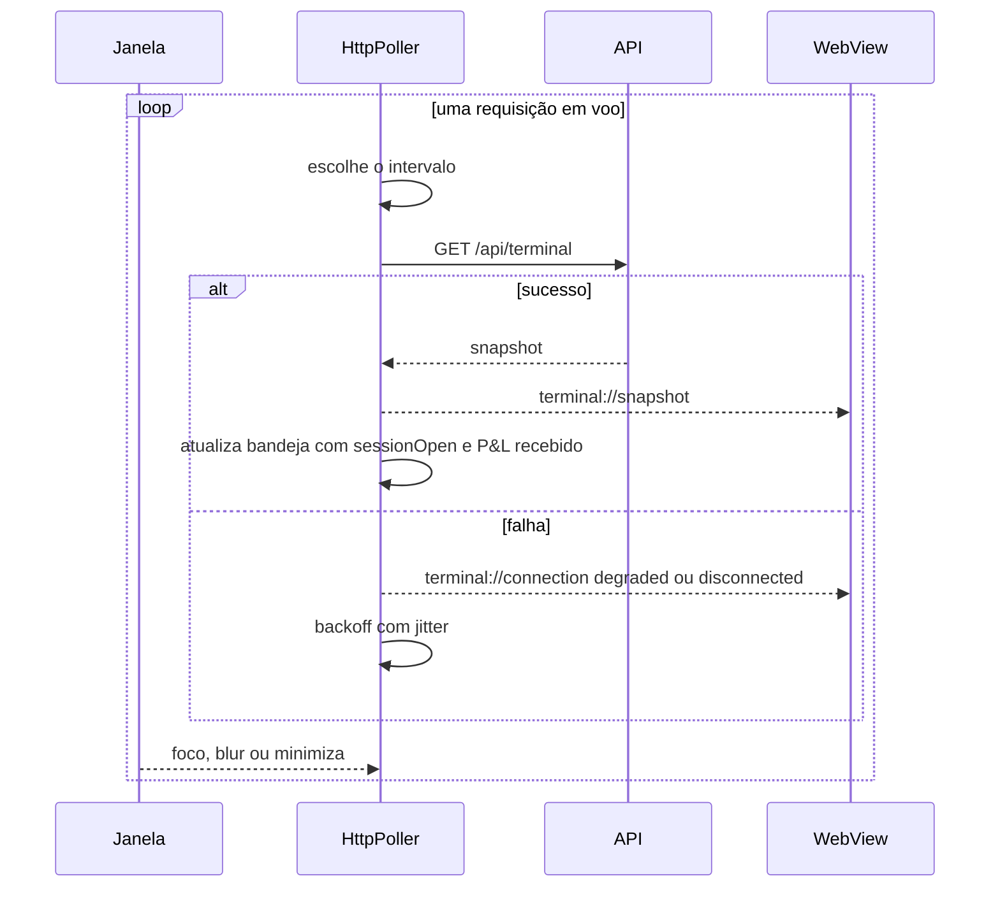
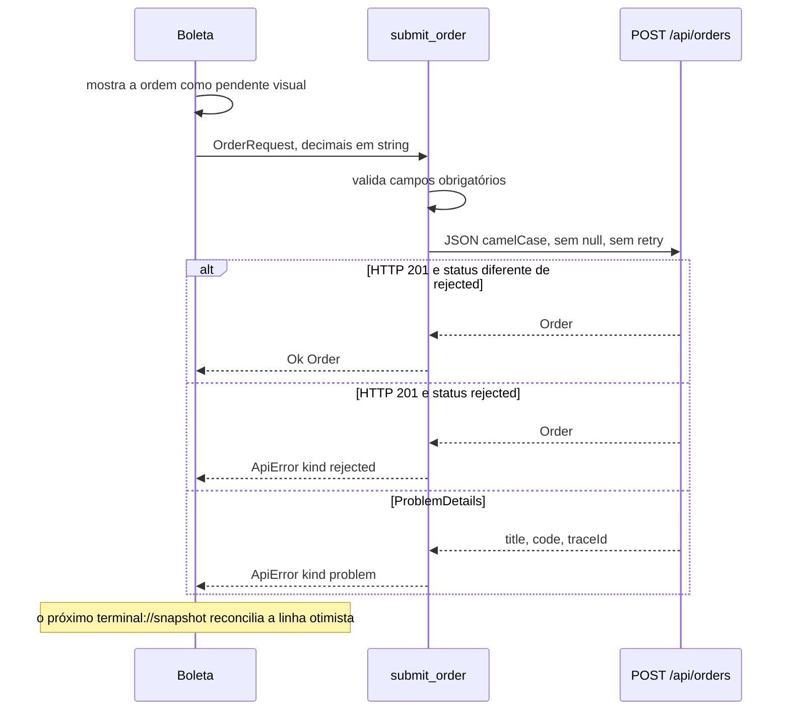
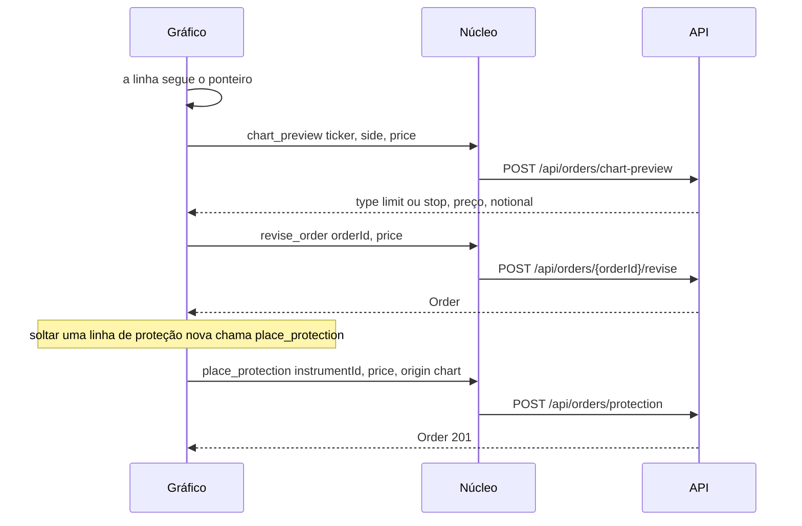

# Vortex Desktop — arquitetura

Estado: ADR-047 aceito em 2026-10-14. F0 a F4 estão em `apps/desktop`: tema, janela, saúde, bandeja, catálogo do snapshot, gráfico do pregão e histórico, boleta, diálogo nativo para reverse, zeragem de emergência e reset, relatórios e CSV. O corte da F5 neste repositório é o `cargo deny check` e `.github/workflows/desktop.yml` (ADR-048). O corte da F6 neste repositório é o menu da estação no macOS (Arquivo, Editar, Exibir, Operar, Ajuda), o diff de `executionId` com o plugin `notification` 2.6.0, o plugin `single-instance` 2.5.3 e o tooltip com o pregão fechado. A barra de menu, a notificação do sistema e um segundo processo não foram vistos nesta máquina. Abrir o AppImage numa Ubuntu 22.04 limpa, o `.dmg` universal notarizado e o updater ficam pendentes. WebKitGTK e WKWebView seguem não medidos; ver `spike-webkit.md`.
O backend e o comportamento do web não mudam.

O estágio do produto continua o ADR-046. A leitura já está em `apps/desktop`. As fases seguintes continuam descritas aqui.

## 1. O que o desktop é

Um binário Tauri 2 por sistema operacional. A WebView desenha a estação. O núcleo Rust fala HTTPS com a API que o Nginx já publica.



Produção: `https://vortexsoftware.tech`. Desenvolvimento: `http://127.0.0.1:5187`. A URL fica na config do núcleo. O JavaScript não a conhece.

## 2. Componentes

| Peça | Responsabilidade | Fora dela |
| --- | --- | --- |
| `ApiClient` | HTTP, timeout, retry de GET, ProblemDetails, decimal em string | Regra de pregão, P&L, risco |
| `SnapshotSource` | Trait do loop. A implementação v1 é `HttpPoller` | Desenho e store |
| `InstrumentDirectory` | Ticker → `instrumentId` a partir do último snapshot ou de `/api/market/quotes` | GUID escrito no código |
| `DangerGate` | Diálogo nativo e token de uso único para reset, emergency-flat e reverse | Confirmação só em React |
| `DesktopConfig` | URL base, tema, último ticker e intervalo. Plugin `store` | Segredo |
| WebView | Estação, formatação de string, estado otimista visual | `fetch` para a API |

`SnapshotSource` existe para o poller ser trocável. A v1 só tem `HttpPoller`. SSE entra se o backend-request correspondente for aceito. O web e o desktop não ganham dois protocolos de push diferentes sem uma decisão única. Ver `backend-requests.md`.

## 3. Sequências

### 3.1 Boot



`sessionOpen == null` significa que o Yahoo ainda não foi lido. A UI mostra "aguardando pregão". O poller usa o intervalo de segundo plano (5 s), não o de pregão aberto.

### 3.2 Poller



Intervalos:

| Situação | Intervalo |
| --- | --- |
| Janela em foco e `sessionOpen == true` | 1,5 s |
| Janela em segundo plano, minimizada, ou `sessionOpen == null` | 5 s |
| `sessionOpen == false` | 30 s |
| Falha de transporte | 1 s, 2 s, 4 s, 8 s, teto 60 s, com jitter de até 20% |

Uma resposta só é aplicada se o número de geração dela for o mais alto já pedido. Resposta antiga é descartada. A bandeja continua no intervalo longo para o ícone não mentir com o pregão fechado.

Falhas seguidas: a primeira marca `degraded` e mantém o snapshot com tarja "desatualizado". A partir da terceira, `disconnected`. Os números de caixa, patrimônio e P&L do cabeçalho somem. A grade permanece visível com o carimbo da hora do último snapshot bom. Isso junta o indicador pedido para o desktop com a regra do ADR-045: saldo antigo não fica parecendo saldo vivo. O ADR-041 continua valendo: falha não é painel vazio.

### 3.3 Envio de ordem



Ordem a mercado não leva `limitPrice`. O command omite o campo quando é `None`.

### 3.4 Arrastar linha de ordem e linha de proteção



O preview não grava ordem. Quem classifica limit ou stop é o servidor, pelo último fechamento. O cliente desenha o `type` que voltou.

## 4. Árvore

```text
apps/desktop/
  package.json
  vite.config.ts
  index.html
  src/
    main.tsx
    bindings/          # gerado por ts-rs, commitado
    ipc/               # invoke tipado, um módulo, sem DTO próprio
    store/terminal.ts  # Zustand
    views/             # composição da estação
  src-tauri/
    Cargo.toml
    Cargo.lock
    rust-toolchain.toml
    tauri.conf.json
    capabilities/default.json
    Entitlements.plist
    src/
      main.rs
      client/          # ApiClient, decimais, erros
      poller/
      commands/
      danger.rs
      tray.rs
packages/trading-core/   # formatação e tipos de view, sem server-only
packages/trading-ui/     # views extraídas, props em vez de contexto Next
```

O web permanece em `apps/web`. Não há workspace npm hoje. A raiz ganha `package.json` com `workspaces` só quando a primeira fatia for extraída. Até lá o desktop tem o próprio `package.json`, no mesmo Node 24.x e npm 11.x do web.

`rust-toolchain.toml` fixa o canal `1.90.0` com `rustfmt` e `clippy`. É o MSRV declarado pelo Tauri `2.12.3`. Os alvos Apple entram nesse arquivo. Subir o canal exige que o `Cargo.lock` seja regerado nos dois sistemas.

## 5. Tela, command, endpoint

| Tela | Commands | Endpoints |
| --- | --- | --- |
| Boot e cabeçalho | `get_config`, `health_live`, evento `terminal://snapshot` | `GET /health/live`, `GET /api/terminal` |
| Bandeja | nenhum command de UI; o poller lê o snapshot | `GET /api/terminal` |
| Visão Geral | snapshot, `get_performance` | `GET /api/terminal`, `GET /api/reports/performance` |
| Mesa, cotações | snapshot, `get_quotes` | `GET /api/terminal`, `GET /api/market/quotes` |
| Mesa, gráfico | `get_chart`, `get_history` | `GET /api/chart`, `GET /api/market/history` |
| Mesa, livro | `get_depth` | `GET /api/market/depth` |
| Boleta | `submit_order`, `chart_preview` | `POST /api/orders`, `POST /api/orders/chart-preview` |
| Linha de ordem | `revise_order`, `cancel_order` | `POST /api/orders/{id}/revise`, `POST /api/orders/{id}/cancel` |
| Proteção | `place_protection` | `POST /api/orders/protection` |
| Posições | `flatten`, `confirm_danger` + `reverse` | `POST /api/orders/flatten`, `POST /api/orders/reverse` |
| Emergência e reset | `confirm_danger` + `emergency_flat` ou `reset_session` | `POST /api/orders/emergency-flat`, `POST /api/session/reset` |
| Histórico | snapshot, `get_trades` | `GET /api/reports/trades` |
| Relatórios | `get_performance`, `export_trades_csv` | `GET /api/reports/performance`, `GET /api/reports/trades` |

`GET /api/trading/market` é legado e não tem command. `POST /api/chart-snapshots` só existe em Development e não tem command.

O CSV é montado no Rust a partir de `ClosedTrade`. O diálogo de salvar abre no núcleo. O JavaScript não recebe o caminho.

## 6. Erros, pregão e reconexão

`ApiError` carrega `kind`, `code`, `title`, `status` e `traceId`. A UI mostra `title`. O log fica com `code` e `traceId`.

| Kind | Quando |
| --- | --- |
| `transport` | DNS, TLS, conexão recusada |
| `timeout` | estourou o prazo do command |
| `problem` | corpo ProblemDetails |
| `rejected` | HTTP 201, ou outro 2xx, com `Order.status == "rejected"` |
| `contract` | JSON que não cabe no DTO, ou decimal que o `rust_decimal` recusa |
| `cancelled` | o operador fechou o diálogo nativo |
| `danger` | reset, reverse ou emergency-flat sem token válido |

Pregão na UI, lido do snapshot, nunca calculado pelo relógio local:

| `sessionOpen` | Indicador |
| --- | --- |
| `true` | Pregão aberto |
| `false` | Pregão fechado. Tape congelado. Boleta explica que a ordem nova não casa até a reabertura |
| `null` | Aguardando a primeira leitura do Yahoo |

Fora do pregão o cliente continua capaz de enviar o que a API aceitar. Quem recusa é o servidor. O cliente não duplica essa regra.

## 7. Decisões da seção 9 do brief

Cada uma compara pelo menos duas alternativas. O resultado está no ADR-047. Aqui fica o critério.

### 7.1 Geração de tipos

| | `ts-rs` 12.0.1 | `tauri-specta` 2.0.0-rc |
| --- | --- | --- |
| Estabilidade em 2026-10-14 | Estável desde 2026-01-31 | Ainda RC. Issue de produção aberta em julho, sem resposta do mantenedor |
| O que gera | Structs e enums | Structs, commands e events |
| Acompanha o Tauri 2.12.3 | Não depende do crate `tauri` | Acoplado à versão do Tauri |

Escolha: `ts-rs`. Os DTOs são a superfície que não pode divergir. Os commands são uma lista fechada em `commands/mod.rs`, e o teste de exportação falha se um DTO público deixar de gerar `.ts`. Trocar para `tauri-specta` quando sair `2.0.0` estável é uma troca de gerador, não de contrato.

### 7.2 Decimal

| | `Decimal` + `serde-with-str` | `String` opaca |
| --- | --- | --- |
| Ida e volta JSON | String, igual ao ADR-002 | String |
| Valor inválido | Erro de contrato na borda | Passa adiante e a API responde 400 |
| CSV e ordenação | Compara no Rust sem float | Exige um parser na hora de ordenar |

Escolha: `rust_decimal` `1.43.0` com `serde-with-str`. A feature `serde-with-float` e a `serde-with-arbitrary-precision` ficam desligadas. Escala máxima 28, a mesma faixa do `decimal` do .NET. String com mais escala vira `contract`, sem arredondar. No TypeScript o tipo gerado é `string`. A UI formata e compara como `format.ts` já faz. Ordenar o CSV é apresentação. P&L continua vindo pronto no snapshot.

### 7.3 Store

Zustand `5.0.15` guarda o último snapshot, a geração, o estado da conexão e o ticker selecionado. O snapshot de 1,5 s não passa por reducer. Redux Toolkit normalizaria ordens que o servidor já manda inteiras. Jotai espalharia um documento que sempre chega junto. O contexto atual do web (`terminal-context.tsx`) continua no web. O desktop não o copia.

### 7.4 Extração compartilhada

Ordem, e o web só muda o import quando o teste da fatia passa:

1. `packages/trading-core` recebe `format.ts` e os helpers puros de `lib/charts/adapter.ts`. Nenhum `import "server-only"`.
2. `packages/trading-ui` recebe views que hoje leem `useTerminal()`, reescritas para props. O web injeta o contexto na borda. O desktop injeta o Zustand.
3. `fetch-snapshot.ts` e `fetch-live-snapshot.ts` ficam em `apps/web`. São Next.
4. `lib/trading/transport.ts` do web continua sendo o HTTP do browser. O desktop não o importa. Os dois hosts preenchem o mesmo view model.

Copiar o componente para `apps/desktop` e editar lá cria um segundo terminal. A extração evita isso. Enquanto a fatia não existe, a fase F0 pode ter uma tela mínima própria, sem reimplementar a mesa.

### 7.5 Gráfico

`pro-trading-chart.tsx` tem 52.942 bytes e importa contexto, playback, labels e proteção. Não vai inteiro para o desktop.

Na extração ele vira quatro módulos, e o web continua montando os quatro no mesmo lugar:

- série e adapter (`lightweight-charts` `5.2.1`);
- playback do candle em formação;
- labels de ordem e o gesto de `revise`;
- campos de proteção e o gesto de `place_protection`.

A logo de atribuição do TradingView sai do pacote Apache-2.0 e é arquivo local. A CSP não deixa buscar o site da TradingView.

### 7.6 Plugins

Versões do catálogo Tauri em 2026-10-14.

| Plugin | Versão | Uso | Capability da WebView |
| --- | --- | --- | --- |
| `window-state` | 2.5.0 | Tamanho e posição da janela principal | Nenhuma. O Rust restaura no boot |
| `store` | 2.5.0 | Tema, URL base, último ticker, intervalo | Nenhuma. Commands `get_config` e `set_base_url` |
| `notification` | 2.6.0 | Fill novo detectado pelo diff do poller | Nenhuma. O Rust notifica |
| `dialog` | 2.7.3 | Confirmação perigosa e salvar CSV | Nenhuma. O Rust abre o diálogo |
| `log` | 2.10.1 | Encaminha `console` da WebView para `tracing` | `log:default` só na janela principal |
| `updater` | 2.13.3 | F5, manifesto em GitHub Releases | Nenhuma. O menu chama `check_update` no Rust |
| `single-instance` | 2.5.3 | Segunda execução foca a janela e o poller único | Plugin de processo, sem IPC remoto |
| tray | API do Tauri 2.12, não é plugin | Pregão e P&L recebido | Nenhuma |
| `global-shortcut` | 2.4.1 | Não entra | Não entra |
| `http`, `fs`, `shell` | — | Não entram | Não entram |

O CSV usa `std::fs` no caminho que o diálogo devolveu. A WebView não ganha escopo de arquivo.

### 7.7 Observabilidade local

`tracing` com arquivo rotacionado no diretório de log do app (`app_log_dir`): diário, 7 arquivos, sem telemetria remota. Cada erro de API vira um span com `code` e `traceId`. Corpo de ordem e de snapshot não é logado em info. Debug de desenvolvimento pode logar o path e o status, não o JSON financeiro.

### 7.8 CI

Os jobs `backend`, `frontend` e `repository-guards` de `.github/workflows/ci.yml` permanecem. O desktop entra em workflow próprio, descrito em `packaging-and-ci.md`, para o build Linux ficar preso em `ubuntu-22.04` e o job de release não cancelar o CI do web.

## 8. Divergências já vistas no repositório

| Onde | Texto | Código, que vence |
| --- | --- | --- |
| README, ADR-045, ADR-046 | Stop e OCO fora do corte | `protection`, `stop`, `flatten`, `reverse`, `revise` em `TradingEndpoints.cs` |
| ADR-039 | Feed determinístico finito e sessão perdida no restart | ADR-045 e ADR-046: Yahoo, `minute_bars`, reset |
| `docs/architecture/overview.md` | Front e providers futuros | README no corte do ADR-046 |
| ADR-041 | Browser chama `/api` na mesma origem | Continua verdade para o web. O desktop fala da URL absoluta a partir do Rust |
| ADR-044 | Botão de robô e paridade com terminal profissional | README: sem robô. O desktop não desenha Algo ON/OFF |

## 9. Fora deste cliente

Backtesting, Strategy Lab, algo trading, book real da B3, conta por usuário e push. Qualquer um desses que precise de endpoint novo vai para `backend-requests.md` antes de existir command.
